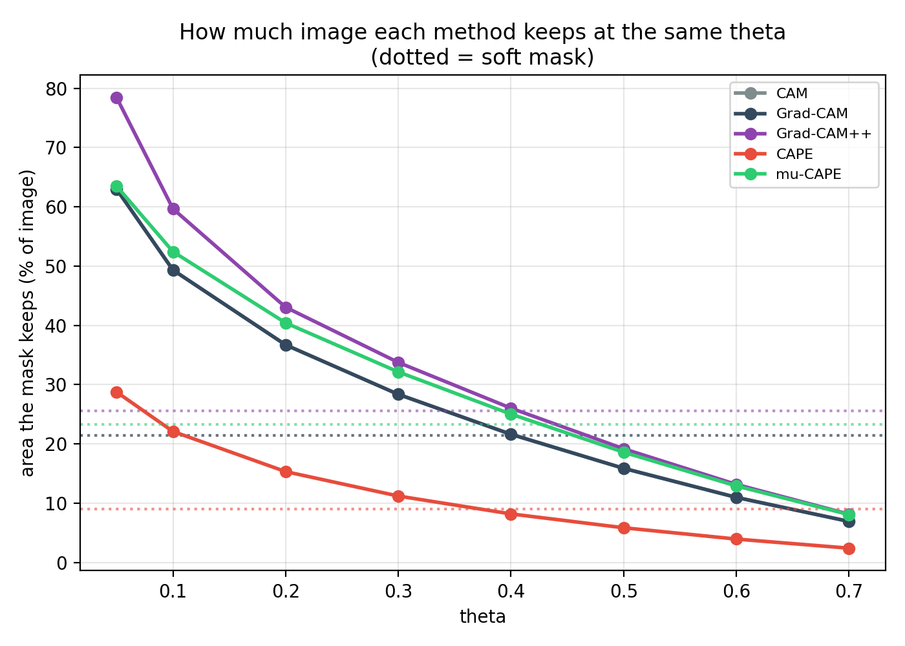
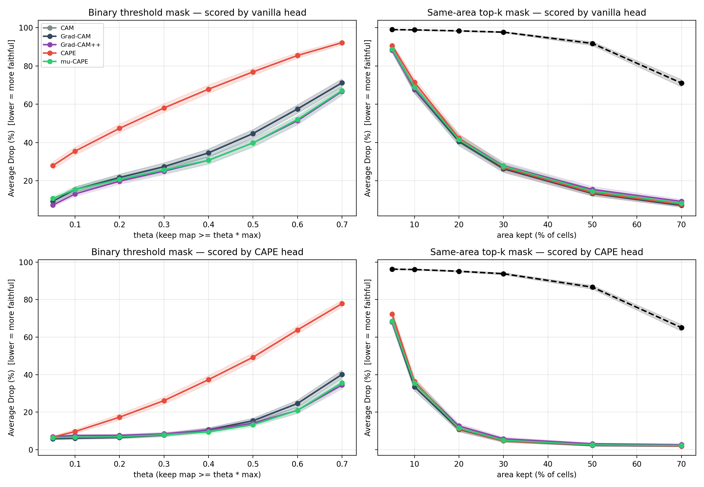

# CAPE Reproduction — Milestones 3 & 4
## Evaluation Fix and Mask-Convention Experiment

## 1. Overview

This work reproduces and evaluates **CAPE: CAM as a Probabilistic Ensemble for Enhanced DNN Interpretation** (CVPR 2024).

The reproduction uses:
- **Dataset:** CUB-200-2011
- **Backbone:** ResNet-50
- **Number of classes:** 200
- **Explanation-map resolution:** 14 × 14
- **CAPE configuration:** Post-fitted (PF) CAPE head
- **Evaluation metrics:** Average Drop (AD), Increase in Confidence (IC), Average Drop in Deletion (ADD), ADCC, mean Intersection over Union (mIoU), and Best Classes (BC).

The work had two main goals:

1. Correct an evaluation issue that affected the reported AD and IC results for CAPE and μ-CAPE.
2. Investigate how much conclusions about explanation faithfulness depend on the convention used to turn an explanation heatmap into an image mask.

The second goal is the main experiment. It compares continuous soft masks, thresholded binary masks, and binary masks that retain the same proportion of image cells.

---

## 2. Evaluation Issue Found and Fixed

### 2.1 What was wrong?

The original implementation in `src/metrics.py` used the vanilla classifier's confidence to evaluate every explanation method.

The problematic expression was:

```python
out['orig']['outcome'].softmax(dim=1)
```

This was appropriate for CAM, Grad-CAM, and Grad-CAM++, which explain the vanilla classifier. However, CAPE and μ-CAPE are intended to explain the CAPE classifier head.

Consequently, the original implementation evaluated CAPE and μ-CAPE explanations using the vanilla head's confidence rather than the CAPE head's own confidence. This made the comparison inconsistent with the intended head-specific evaluation.

### 2.2 What was changed?

The evaluation now uses the classifier head corresponding to the explanation method:

| Explanation method | Classifier head used for evaluation |
|---|---|
| CAM | Vanilla (`orig`) |
| Grad-CAM | Vanilla (`orig`) |
| Grad-CAM++ | Vanilla (`orig`) |
| CAPE | CAPE (`cape`) |
| μ-CAPE | CAPE (`cape`) |

The vanilla head produces logits, so its output is converted to probabilities with softmax:

```python
out['orig']['outcome'].softmax(dim=1)
```

The CAPE head's `outcome` is already a probability distribution, so it is used directly:

```python
out['cape']['outcome']
```

**Important:** Softmax must not be applied to `out['cape']['outcome']` again.

### 2.3 Corrected results

The following table shows the corrected reproduction results.

| Method | AD ↓ | IC ↑ | ADD ↑ | ADCC ↑ | mIoU ↓ | BC ↑ |
|---|---:|---:|---:|---:|---:|---:|
| CAM | 24.40 | 24.46 | 64.96 | 78.00 | 74.91 | 4 |
| Grad-CAM | 24.40 | 24.42 | 64.96 | 77.99 | 74.91 | 2 |
| Grad-CAM++ | 22.18 | 26.23 | 67.66 | 78.17 | 90.40 | 8 |
| CAPE (PF) | 33.55 | 25.61 | 52.04 | 74.66 | 26.97 | 4 |
| μ-CAPE (PF) | 11.24 | 46.96 | 71.48 | 85.74 | 83.29 | 12 |

Arrows indicate the preferred direction of each metric. These are reproduced values, not the paper's reported values.

### 2.4 Comparison with the paper

For reference, the corresponding values reported in the paper are:

| Method | AD ↓ | IC ↑ | ADD ↑ | ADCC ↑ | mIoU ↑ | BC ↑ |
|---|---:|---:|---:|---:|---:|---:|
| CAM | 21.2 | 27.9 | 67.4 | 78.8 | 75.9 | 0 |
| CAPE (PF) | 22.2 | 26.5 | 68.7 | 73.7 | 13.4 | 3 |
| μ-CAPE (PF) | 15.9 | 30.9 | 69.6 | 83.0 | 66.6 | 5 |

The corrected evaluation changed the CAPE and μ-CAPE confidence-based metrics, particularly AD and IC. Their maps did not change, so metrics calculated from the maps, such as mIoU, were not expected to change as a result of this evaluator fix alone.

The reproduced values do not match every number in the paper. In particular, the corrected CAPE AD remains substantially higher than the paper's reported CAPE AD. The correction fixes the identified head-selection error, but it does not establish that every remaining discrepancy has been resolved.

The BC values also require caution: the paper evaluates a larger set of methods, whereas this reproduction compares five methods. The reproduced BC values therefore should not be interpreted as directly equivalent rankings under the paper's full comparison.

### 2.5 Additional sanity checks

The following checks are useful before treating the reproduction as fully validated:

- [ ] Confirm vanilla-head test accuracy against the paper's reported value of 83.34%.
- [ ] Confirm CAPE PF-head test accuracy against the paper's reported value of 82.12%.
- [ ] Verify that CAPE's weighted regional contributions sum to the relevant class confidence, using the model's intended output convention.
- [ ] Confirm that the CAPE head is initialized as described in the paper. In particular, inspect whether the PF training script initializes the CAPE classifier from the vanilla classifier or loads weights from a previously trained CAPE/TS checkpoint.
- [ ] Investigate remaining differences between the reproduced and reported metrics.

The accuracy values above are reference values from the paper, not claims that these checks have already passed.

---

## 3. Main Experiment: Does the Masking Convention Change the AD Ranking?

### 3.1 Research question

**How much do conclusions about CAPE's faithfulness relative to CAM depend on how explanation heatmaps are converted into image masks?**

This question follows directly from the reproduction results. AD evaluates how much a model's confidence falls when an explanation mask is applied to an image. However, the amount of image retained can differ substantially between explanation methods.

If one explanation retains much less of the original image than another, their AD values may reflect differences in both the selected regions and the amount of image left visible.

The experiment therefore separates three masking conventions to examine whether the relative AD results are stable across them.

### 3.2 Experimental setup

The experiment uses the reproduced ResNet-50 model and CUB-200-2011 test data.

| Setting | Value |
|---|---|
| Explanation methods | CAM, Grad-CAM, Grad-CAM++, CAPE, μ-CAPE |
| Classifier heads | Vanilla (`orig`) and CAPE (`cape`) |
| Heatmap resolution | 14 × 14 |
| Number of evaluated images | 1,000 |
| Image selection seed | 123 |
| Binary thresholds | 0.05, 0.10, 0.20, 0.30, 0.40, 0.50, 0.60, 0.70 |
| Top-k retained areas | 5%, 10%, 20%, 30%, 50%, 70% |
| Bootstrap resamples | 2,000 |
| Confidence intervals | 95% paired-bootstrap intervals over images |

The experiment selects 1,000 images without replacement from the test data using seed 123. It does not evaluate the entire test set.

For each image, the predicted class is determined by the vanilla classifier:

\[
c = \arg\max_j p_{\mathrm{orig}}(j \mid x)
\]

All explanation methods generate their maps for this same predicted class. Each masked image is then evaluated by both classifier heads.

This shared setup allows the same explanation and masking condition to be compared under the vanilla and CAPE heads.

### 3.3 Metric: Average Drop

Average Drop measures the relative decrease in the original predicted-class confidence after masking an image.

For an image \(x\), its explanation mask \(M\), predicted class \(c\), and classifier head \(h\), the per-image quantity is:

\[
AD(x,M,h)=
\max\left(
\frac{p_h(c\mid x)-p_h(c\mid x\odot M)}
{\max(p_h(c\mid x),10^{-6})},
0
\right)
\]

The reported AD is the mean of this quantity across the evaluated images, multiplied by 100.

Here, \(x\odot M\) denotes the image after applying the mask. For soft masks, pixel values are multiplied by mask values between zero and one. For binary masks, pixels are either retained or set to zero in the normalized input representation.

**Lower AD is considered better under this metric:** the model retains more of its original confidence after the mask is applied.

AD is a measure of confidence preservation under this masking procedure. It is not, by itself, proof that a highlighted region is causally important or that an explanation is semantically correct.

### 3.4 The three masking conventions

#### A. Soft mask

The continuous explanation map is used directly as a mask.

If \(E_c\) is the explanation map for class \(c\), the masked image is:

\[
x_{\mathrm{soft}}=x\odot E_c
\]

The 14 × 14 map is bilinearly upsampled to the input image resolution and clamped to the range \([0,1]\).

This is the soft-mask condition used by the experiment and the convention corresponding to the reproduction's main `metrics.py` evaluation.

Soft masks can retain different effective amounts of the image because the maps have different value distributions.

#### B. Binary threshold masks

A binary mask retains cells whose heatmap values are at least a fraction \(\theta\) of the maximum map value:

\[
M_{ij}=
\begin{cases}
1 & E_{ij}\geq \theta\max(E)\\
0 & \text{otherwise}
\end{cases}
\]

The experiment uses:

\[
\theta\in
\{0.05,0.10,0.20,0.30,0.40,0.50,0.60,0.70\}
\]

The binary map is bilinearly upsampled to the input resolution before thresholding, as implemented in the experiment code. Since the upsampled mask is binary at that point, the resulting mask is binary.

As \(\theta\) increases, fewer pixels are generally retained. However, the proportion retained is not the same across methods at the same threshold because their heatmap values differ.

If a map has no positive maximum, the implementation retains no pixels for that threshold condition.

#### C. Same-area top-k masks

This condition retains exactly the \(K\%\) highest-valued cells of each 14 × 14 map:

\[
K\in\{5,10,20,30,50,70\}
\]

For each image and method, the implementation sorts the 196 heatmap cells and retains the top \(K\%\), using a stable ordering to break ties. It then upsamples the binary mask using nearest-neighbor interpolation.

Unlike a fixed threshold, top-k ensures that all explanation methods retain the same number of heatmap cells for a given \(K\). This helps separate the effect of **which regions are selected** from the effect of **how much image area is retained**.

Because 196 cells cannot represent every percentage exactly, the retained cell count is rounded to the nearest integer, with at least one cell retained.

Ties are broken deterministically by the stable sorting order. This matters when heatmaps contain many equal values, particularly zeros.

### 3.5 Random control

The experiment includes a random-mask baseline for each top-k retained area.

For each image and each \(K\), the random control retains the same number of cells, but chooses their locations randomly instead of using explanation values.

This provides a reference for evaluating whether selecting regions according to an explanation map performs better than retaining an arbitrary subset of the image.

The random mask is generated reproducibly using a seed derived from the experiment seed and image index. The same random control is therefore used when rerunning the same configuration.

The random control is included for the top-k condition only, not for soft or threshold masks.

### 3.6 Comparing classifier heads

Every masked image is scored by both heads:

- **Vanilla head (`orig`):** its logits are converted to probabilities using softmax.
- **CAPE head (`cape`):** its probability outputs are used directly.

This is important because AD depends on the original and masked-image confidence of the head being evaluated.

For the main soft-mask comparison, the results are paired as follows:

| Methods | Head used for the main comparison |
|---|---|
| CAM, Grad-CAM, Grad-CAM++ | Vanilla head |
| CAPE, μ-CAPE | CAPE head |

This pairing follows the intended interpretation that CAM-family methods explain the vanilla classifier, while CAPE-family methods explain the CAPE classifier.

The additional results scored by the other head are also retained. These make it possible to distinguish differences caused by the explanation method from differences associated with the classifier head.

---

## 4. Results

### 4.1 How much image does each method retain?

The following figure shows the average fraction of the image retained under each binary threshold. The dotted horizontal lines indicate each method's average retained area under its soft mask.



**Figure 1. Retained image area under binary threshold masks.** The x-axis is the relative threshold \(\theta\); the y-axis is the average retained image area. Dotted lines show the average area retained by the corresponding soft mask.

The results show that the same threshold does not produce comparable retained areas across explanation methods.

For example, at \(\theta=0.30\):

- CAPE retains approximately 11.2% of the image.
- CAM retains approximately 28.4% of the image.
- Grad-CAM++ retains approximately 33.5% of the image.
- μ-CAPE retains approximately 32.2% of the image.
- Grad-CAM retains approximately 28.4% of the image.

The soft masks also have different average retained areas. CAPE's soft mask retains approximately 9.0% of the image, compared with approximately 21.4% for CAM, 21.4% for Grad-CAM, 25.6% for Grad-CAM++, and 23.3% for μ-CAPE.

These differences matter because AD measures confidence after applying a mask. A method retaining a smaller fraction of the image is evaluated under a different degree of image removal than a method retaining a much larger fraction.

The figure therefore motivates the same-area top-k condition: it controls the retained area so the methods can be compared under a more consistent masking budget.

### 4.2 AD under different masking conventions



**Figure 2. Average Drop under binary threshold masks and same-area top-k masks.** The top row shows results scored by the vanilla head; the bottom row shows results scored by the CAPE head. The left column varies the relative threshold, while the right column fixes the retained area. Lower AD indicates greater confidence preservation. Shaded bands show the 95% bootstrap confidence intervals over images.

The figure reveals different patterns under the threshold and top-k conventions.

#### Binary threshold masks

As the threshold increases, AD generally increases because progressively less of the image is retained. This trend appears across the methods and both classifier heads.

CAPE has particularly high AD under the binary threshold condition. At a given threshold, it often retains much less image area than the other methods, as shown in Figure 1.

Consequently, comparing methods at the same threshold does not isolate the quality of the selected regions: the methods can be retaining substantially different amounts of the input.

#### Same-area top-k masks

When the retained area is fixed, the AD curves become much closer for the explanation methods.

On the vanilla head, the explanation methods generally show similar AD values at the larger retained areas. The random control, by contrast, has substantially higher AD throughout the tested top-k range.

On the CAPE head, the explanation methods also become close at retained areas of 20% and above. At these larger retained areas, AD approaches a low floor, so the remaining numerical differences between methods are small.

This suggests that the apparent relative performance of explanation methods depends in part on the masking convention. Threshold masks couple the selected regions with the amount of image retained, while top-k masks control the retained area directly.

### 4.3 Matched-area threshold comparisons

A further comparison matches methods by their observed average retained areas, even when their thresholds differ.

The following values are approximate average AD and retained area percentages from the experiment:

| Head | Method and threshold | Area retained | AD (%) |
|---|---|---:|---:|
| Vanilla | CAPE, \(\theta=0.05\) | 28.7% | 27.9 |
| Vanilla | CAM, \(\theta=0.30\) | 28.4% | 27.4 |
| Vanilla | CAPE, \(\theta=0.10\) | 22.1% | 35.4 |
| Vanilla | CAM, \(\theta=0.40\) | 21.6% | 34.6 |
| Vanilla | CAPE, \(\theta=0.30\) | 11.2% | 58.0 |
| Vanilla | CAM, \(\theta=0.60\) | 11.0% | 57.5 |
| CAPE | CAPE, \(\theta=0.05\) | 28.7% | 6.7 |
| CAPE | CAM, \(\theta=0.30\) | 28.4% | 7.8 |
| CAPE | CAPE, \(\theta=0.10\) | 22.1% | 9.7 |
| CAPE | CAM, \(\theta=0.40\) | 21.6% | 10.6 |
| CAPE | CAPE, \(\theta=0.30\) | 11.2% | 26.2 |
| CAPE | CAM, \(\theta=0.60\) | 11.0% | 24.6 |

These comparisons reinforce the pattern seen in the top-k experiment: when CAPE and CAM retain approximately the same fraction of the image, their AD values become much closer than in the original soft-mask comparison.

For the vanilla head, the matched-area AD differences in these examples are less than one percentage point. For the CAPE head, the differences are also small, although their direction varies by retained area.

These are comparisons at approximately matched **average** retained areas. They do not guarantee that every individual image retains exactly the same area under both methods.

### 4.4 Same-area top-k comparison

The paired differences provide another way to assess the methods.

For CAPE versus Grad-CAM on the CAPE head, the approximate mean AD difference (CAPE minus Grad-CAM), in percentage points, is:

| Retained area | AD difference |
|---|---:|
| 5% | +4.2 |
| 10% | +2.9 |
| 20% | +0.3 |
| 30% | +0.1 |
| 50% | +0.2 |
| 70% | +0.1 |

A positive difference means CAPE has higher AD and is therefore worse under this metric.

CAPE has higher AD than Grad-CAM at 5% and 10% retained area. At 20%, 30%, and 70%, the paired-bootstrap confidence intervals include zero, so the experiment does not establish a clear difference for those comparisons. The reported difference at 50% is also small.

At larger retained areas, all methods have low AD, so the numerical differences become small. This limits how much can be inferred from the small gaps alone.

The random control is much worse than the explanation-based masks. For example, at 30% retained area on the vanilla head, the methods have AD values in roughly the 26–28% range, while the random control has AD around 97.7%.

This provides evidence that selecting cells based on the explanation maps performs substantially better than choosing cells at random under this masking procedure.

### 4.5 The classifier head also matters

The same explanation map can produce different AD values when evaluated by different classifier heads.

For example, CAM has an AD of approximately 24.3% when evaluated by the vanilla head and approximately 13.0% when evaluated by the CAPE head in the soft-mask comparison.

Similarly, μ-CAPE's AD advantage over CAM is much smaller when both methods are scored by the same head than when each method is scored by its corresponding head in the main table.

The main soft-mask comparison reports approximately:

- CAM, scored by the vanilla head: AD = 24.4%.
- μ-CAPE, scored by the CAPE head: AD = 11.2%.

This difference combines the choice of explanation method with the choice of classifier head. It should not be interpreted as a pure explanation-method effect.

When CAM and μ-CAPE are compared under the same head, the AD gap is much smaller. This shows why head selection needs to be controlled when interpreting faithfulness comparisons.

The experiment does not establish the mechanism behind the different head responses. One possible explanation is that the heads have different confidence distributions, but that hypothesis would require a separate analysis.

### 4.6 Ranking stability

The relative ranking of explanation methods is not invariant across masking conventions.

- Under soft masks and most tested binary thresholds, Grad-CAM++ has the lowest AD among the methods on the vanilla head.
- Under top-k masks on the vanilla head, CAM is best at retained areas of 10% and above.
- CAPE has comparatively high AD under soft and threshold masks.
- Under same-area top-k masks, CAPE's AD becomes much closer to the other explanation methods, particularly at retained areas of 20% and above.
- The random control performs substantially worse than the explanation-based masks in the top-k condition.

These observations support the conclusion that AD rankings can depend on the masking convention. They do not imply that all masking conventions are equally appropriate, or that equal retained area makes AD a complete measure of explanation quality.

---

## 5. Main Findings

The experiment supports the following conclusions.

### Finding 1: Masking convention changes the comparison

The relative AD values and rankings of explanation methods vary across soft, threshold, and top-k masks. Therefore, a faithfulness ranking obtained using one masking convention should not automatically be assumed to hold under another.

### Finding 2: Equal thresholds do not mean equal retained areas

Different heatmaps have different value distributions. Applying the same relative threshold can therefore retain very different proportions of the image.

This is particularly important for CAPE, whose threshold masks can retain substantially less image area than the masks produced by CAM-family methods.

### Finding 3: Matching retained area narrows the CAPE–CAM gap

When CAPE and CAM retain approximately the same amount of image, their AD values are much closer than in the original soft-mask comparison.

This indicates that the amount of retained image is an important factor in the observed AD difference.

It does **not** show that retained area is the only factor responsible for the difference. The experiment does not establish that CAPE and CAM select equally informative regions, nor that their faithfulness is equivalent under every evaluation procedure.

### Finding 4: The classifier head must be controlled

AD depends on the head whose confidence is measured. Comparing CAPE-family methods using the CAPE head against CAM-family methods using the vanilla head combines two sources of variation.

The additional same-head comparisons show that this can materially affect the interpretation of the results.

### Finding 5: Explanation-based selection outperforms the random control

Under same-area top-k masking, the explanation methods retain much more of the original class confidence than random masks do. This supports the usefulness of the explanation maps for selecting image regions under the experiment's masking procedure.

### Overall conclusion

The experiment shows that conclusions about CAPE's faithfulness relative to CAM are sensitive to how explanation maps are converted into masks and which classifier head is used for evaluation.

The strongest supported conclusion is that **AD is not independent of the masking convention or the retained image area**. Same-area comparisons provide a more controlled view of the selected regions, but they do not establish a universal ranking of explanation methods.

---

## 6. Relationship to the Paper's Claims

| Paper-related question | Reproduction result | Interpretation |
|---|---|---|
| Do CAPE's regional contributions represent its class confidence? | Additional numerical sanity check remains to be completed. | Do not claim this property has been verified until the check passes. |
| Does CAPE produce more class-discriminative maps, as assessed by mIoU? | Reproduced CAPE mIoU is 26.97 versus CAM's 74.91. | The reproduced direction is consistent with lower CAPE mIoU, but the values do not exactly match the paper. |
| Does CAPE have AD comparable to CAM? | Not supported by the original soft-mask comparison: CAPE PF has AD 33.55 versus CAM's 24.40. | The evaluator fix does not eliminate the gap. Under matched-area masking, the gap narrows considerably in the tested examples. |
| Does μ-CAPE have the best AD? | μ-CAPE PF has AD 11.24 in the main soft-mask table. | Its apparent advantage over CAM is smaller when the two methods are scored by the same head. |
| Are the reproduced BC values directly comparable to the paper? | The reproduction evaluates five methods rather than the paper's larger method set. | Treat BC as a limited within-reproduction result, not a directly equivalent full-table ranking. |

The results should be presented as a reproduction with an evaluation correction and a targeted follow-up experiment, rather than as an exact reproduction of every reported paper result.

---

## 7. Limitations and Threats to Validity

Several limitations constrain the conclusions.

### Dataset and sample size

The experiment evaluates 1,000 test images, selected without replacement using a fixed seed, rather than all 5,794 test images. The findings may vary with the sample or model checkpoint.

### One checkpoint and seed

The experiment uses one checkpoint and a fixed image-selection seed. It does not establish that the findings generalize across independently trained model seeds.

### Bootstrap interpretation

The 95% paired-bootstrap confidence intervals are calculated by resampling images. They quantify uncertainty across the evaluated image sample under this setup; they do not account for variability across model training runs or checkpoints.

The shared bootstrap indices make method comparisons paired at the image level.

### Masking convention

The three conditions implement different ways of applying explanation maps. Soft masks preserve continuous values, threshold masks retain cells according to a relative cutoff, and top-k masks retain a fixed number of cells.

Their results are therefore conditional on these specific implementations. Equal-area masking controls retained area, but it does not make the selected regions or their spatial structure identical.

### Input preprocessing

Masks are applied to the transformed input tensor. Since the image is normalized, setting masked pixels to zero in tensor space corresponds to the normalized-space baseline, not necessarily literal black pixels in the original image.

### Heatmap resolution and interpolation

The maps are generated at 14 × 14 resolution. Soft and threshold masks use bilinear upsampling; top-k masks use nearest-neighbor upsampling. These choices can affect the spatial appearance of the masks and the measured AD.

### Ties in top-k masks

Some heatmaps contain many equal-valued cells, including zeros. Stable sorting makes the selection reproducible, but tied cells may be selected according to their raster order rather than a meaningful distinction in importance.

### Metric scope

AD measures confidence preservation after masking. It does not fully measure localization accuracy, semantic correctness, or causal importance. The experiment's conclusion is therefore specifically about AD under the tested masking procedures.

### Remaining reproduction differences

The corrected evaluation does not explain every discrepancy between the reproduced results and the paper. Head accuracy, CAPE initialization, preprocessing, and metric implementation still need to be checked before attributing all remaining differences to the paper's method.

---

## 8. Reproducibility

### 8.1 Evaluate the corrected main metrics

Run the corrected evaluation on the checkpoint and processed test data:

```bash
python src/metrics.py \
    --checkpoint <best.pth> \
    --processed_dir <dir with test.pkl> \
    --num_images 5794
```

Replace `<best.pth>` with the checkpoint path and `<dir with test.pkl>` with the directory containing `test.pkl`.

### 8.2 Run the mask-convention experiment

```bash
python experiments/mask_convention_experiment.py \
    --checkpoint <best.pth> \
    --processed_dir <dir with test.pkl> \
    --output_dir results/mask_convention \
    --num_images 1000
```

The default settings include seed 123, 2,000 bootstrap resamples, and a batch size of 16 masked images per forward pass.

To reduce memory use, lower the batch size:

```bash
python experiments/mask_convention_experiment.py \
    --checkpoint <best.pth> \
    --processed_dir <dir with test.pkl> \
    --output_dir results/mask_convention \
    --num_images 1000 \
    --batch_size 8
```

The script checkpoints progress every 50 images by default. If interrupted, rerun the identical command with the same output directory to resume. The saved configuration is checked before resuming; a mismatched configuration raises an error.

### 8.3 Experiment outputs

The experiment writes the following files to the output directory:

| File | Purpose |
|---|---|
| `ad_summary.csv` | Mean AD, confidence-interval bounds, and mean retained area for each head, condition, and method. |
| `paired_differences.csv` | Paired AD differences and 95% bootstrap confidence intervals for the specified method pairs. |
| `ad_vs_mask_convention.png` | AD curves for binary threshold and same-area top-k masks, shown separately for the vanilla and CAPE heads. |
| `kept_area_vs_theta.png` | Average retained image area across binary thresholds, with soft-mask retained areas shown as dotted lines. |
| `per_image.pkl` | Per-image AD and retained-area results, selected indices, and run configuration. |
| `run_config.json` | Configuration used for the completed run. |

During execution, `experiment_checkpoint.pkl` stores resumable progress. It is removed after a successful completion; the final per-image results are then saved to `per_image.pkl`.

The CSV summaries and plots are generated after the per-image evaluation is complete.

---

## 9. Implementation Notes

The experiment is implemented in `experiments/mask_convention_experiment.py`.

Key implementation details:

- `generate_all_maps` generates the five explanation maps for the vanilla head's predicted class.
- Every masked image is scored by both classifier heads.
- Vanilla logits are converted to probabilities with softmax; CAPE-head probability outputs are used directly.
- Soft masks use bilinear interpolation and continuous mask values.
- Threshold masks apply the relative cutoff after bilinear interpolation.
- Top-k masks select cells at the 14 × 14 resolution and use nearest-neighbor interpolation.
- Random top-k masks retain the same number of cells as the corresponding top-k explanation mask.
- A shared set of bootstrap indices is used for all paired comparisons.
- Per-image results are checkpointed so the experiment can resume after interruption.
- The final CSV files retain the means and both confidence-interval bounds, even though the printed report displays the mean and the interval's half-width.

The experiment reports mean AD in percentage points. In the paired-difference table, a negative value for `a - b` means method `a` has lower AD than method `b` and is therefore better under this metric.

---

## 10. Final Summary

The first part of this work corrected a head-selection error in the evaluation code: CAPE and μ-CAPE explanations must be evaluated using the CAPE head's probabilities rather than the vanilla head's probabilities. The corrected results improve the validity of the comparison, although several differences from the paper remain unresolved.

The main experiment investigates whether the relative AD performance of explanation methods changes when the masking convention changes. It compares soft masks, binary relative-threshold masks, and same-area top-k masks, evaluates all methods using both classifier heads, and includes a random-mask control.

The results show that equal thresholds can retain very different amounts of image, and that matching the retained area makes CAPE and CAM's AD values much closer in the tested comparisons. The random control performs substantially worse than explanation-based masks.

The main lesson is that **AD rankings depend partly on the masking procedure and the classifier head used for scoring**. Results from different explanation methods should therefore be interpreted alongside their masking conventions, retained image areas, and evaluation heads.
